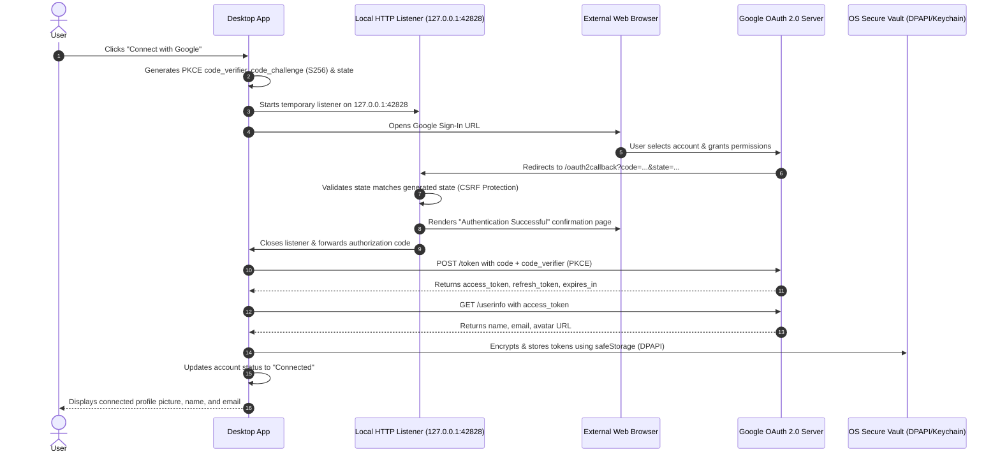

# Google OAuth 2.0 Integration & Setup Guide

This desktop application connects to Google using the official **Google OAuth 2.0 Authorization Code Flow with PKCE (`S256`)** and a secure local loopback listener (`http://127.0.0.1:42828/oauth2callback`).

---

## 1. Quick Setup in Google Cloud Console

Follow these steps to obtain your official Google Cloud OAuth Client ID:

### Step 1: Create a Project
1. Visit the [Google Cloud Console](https://console.cloud.google.com/).
2. Click **Select a project** (top bar) > **New Project**.
3. Name it (e.g., `Social-Earnings-Studio`) and click **Create**.

### Step 2: Configure the OAuth Consent Screen
1. In the left navigation, go to **APIs & Services** > **OAuth consent screen**.
2. Select **External** (or **Internal** if using a Google Workspace organization) and click **Create**.
3. Fill in the required fields:
   - **App name**: `Social Earnings Studio`
   - **User support email**: Your email address
   - **Developer contact information**: Your email address
4. Click **Save and Continue**.
5. On the **Scopes** page, click **Add or Remove Scopes** and add:
   - `openid`
   - `.../auth/userinfo.email`
   - `.../auth/userinfo.profile`
   - `.../auth/youtube.readonly`
   - `.../auth/youtube.upload`
6. Click **Save and Continue**.
7. If your app is in "Testing" status, add your Google account to **Test Users**.
8. Click **Save and Continue**.

### Step 3: Enable Google APIs
In **APIs & Services** > **Library**, search for and **Enable** the following:
- **YouTube Data API v3**
- **Google People API**

### Step 4: Create Desktop OAuth Credentials
1. In the left navigation, go to **APIs & Services** > **Credentials**.
2. Click **Create Credentials** (top toolbar) > **OAuth client ID**.
3. In **Application type**, select **Desktop app**.
4. In **Name**, enter: `Social Earnings Studio Desktop`.
5. Under **Authorized redirect URIs**, add:
   ```
   http://127.0.0.1:42828/oauth2callback
   ```
6. Click **Create**.
7. A dialog will show your **Client ID** (e.g. `123456789-abcdef.apps.googleusercontent.com`). Copy this value.
   > **Note on Client Secret**: Because this is a native desktop application, Google uses PKCE (`S256`) for cryptographic authentication. Client Secrets are not required or embedded in distributed desktop applications.

---

## 2. Configuring the Client ID in the Desktop App

You can configure your Client ID in any of the following ways:

### Method A: In-App UI (Recommended)
1. Open the desktop application.
2. Go to either **Social Accounts** or **Settings**.
3. In the **Google Account** card, click **Config Client ID**.
4. Paste your **Client ID** and click **Save Configuration**.

### Method B: Environment Variable
Add the following line to your `.env` file in the project root:
```env
GOOGLE_CLIENT_ID=your_client_id_here.apps.googleusercontent.com
```

---

## 3. How the Authentication Flow Works



---

## 4. Security & Privacy Guarantees

1. **No Embedded Webviews / Direct Password Input**:
   - Authentication takes place exclusively in the user's official default web browser directly with Google's servers. The app never asks for, intercepts, or sees the user's password.
2. **PKCE (Proof Key for Code Exchange - RFC 7636)**:
   - Cryptographic `code_challenge` (`S256`) and high-entropy `code_verifier` prevent authorization code interception and replay attacks.
3. **State Parameter CSRF Protection**:
   - Cryptographically random state parameter generated per session; rejected immediately if mismatched.
4. **OS-Level Credential Encryption**:
   - Refresh tokens and access tokens are encrypted using Electron's `safeStorage` (Windows DPAPI / macOS Keychain). They are never saved in plaintext files, logs, or local storage.
5. **Session Cleanup & Revocation**:
   - Clicking **Disconnect** revokes the token at `https://oauth2.googleapis.com/revoke` and wipes stored secrets from the operating system's vault.
